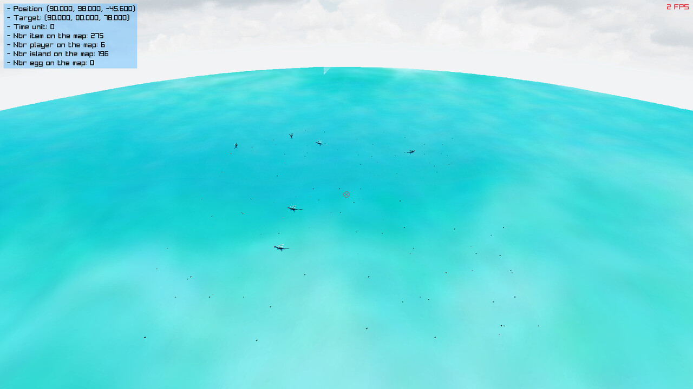

<div align="center">

# Zappy

**A multiplayer game played by AIs: a C server, autonomous AI clients and a 3D viewer.**

    

<sub>Team of 6 · May – June 2024</sub>

</div>

<p align="center"></p>
<p align="center"><sub>The 3D viewer connected to a live server: 6 players, resources scattered across the map.</sub></p>


## About the project

Zappy is a networked game in which teams of **AI players** live on a tile-based world. They look around, collect resources, broadcast messages to each other, lay eggs and perform *incantations* to level up. Nobody plays by hand: each player is a program talking to the server over TCP.

The project has three parts, built by three sub-teams:

| Part | Language | What it does |
|---|---|---|
| [`server/`](server) | C | Owns the whole game: world, time, teams, commands, victory conditions |
| [`ai/`](ai) | C++ | Autonomous player clients that decide what to do from what they see |
| [`gui/`](gui) | C++ / raylib | 3D viewer that displays what the server sends to a graphical client |

## Run it

```bash
make                      # builds zappy_server, zappy_ai and zappy_gui

./zappy_server -p 4242 -x 14 -y 14 -n red blue -c 6 -f 100
./zappy_ai  -p 4242 -n red  -h 127.0.0.1     # start as many as you like
./zappy_gui -p 4242 -h 127.0.0.1
```

The GUI needs [raylib](https://www.raylib.com/) and the AI needs [Asio](https://think-async.com/Asio/). The server's options and protocol are documented in [`server/README.md`](server/README.md).

## My contribution

I worked on the **server, in C**: 112 of the project's 527 commits, about 6,400 lines added.

- **Player commands**: the `look` command, the `broadcast` direction maths (which tile a message comes from), and the item commands, with fixes found while testing against the AI
- **Graphical protocol**: the commands the server sends to the viewer, including `pbc` (broadcast), `pgt` (resource taken), `pie` (end of incantation), `pew` (eject), `ebo` (egg hatched), `sgt` (time unit), `ppo` and `pin`
- **Game rules**: the win condition for a team, and starting levels
- **Architecture**: I split the command handling into separate IA and GUI command sets so each protocol could grow on its own
- **Robustness**: clean disconnection of players, including the case where a client is killed with Ctrl-C
- **Tests**: unit tests with Criterion for the item and GUI commands

## Team

Yanis Harkouk, Eva Legrand, Paul Bardeur, Edward Lalande, Mathis Brehm, Timothée Plisson. The server is documented as the work of Eva Legrand and Yanis Harkouk, and the viewer as the work of Mathis Brehm and Timothée Plisson.
